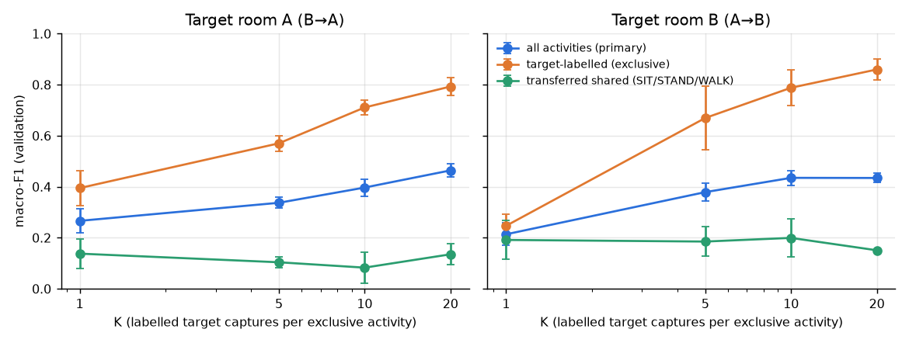
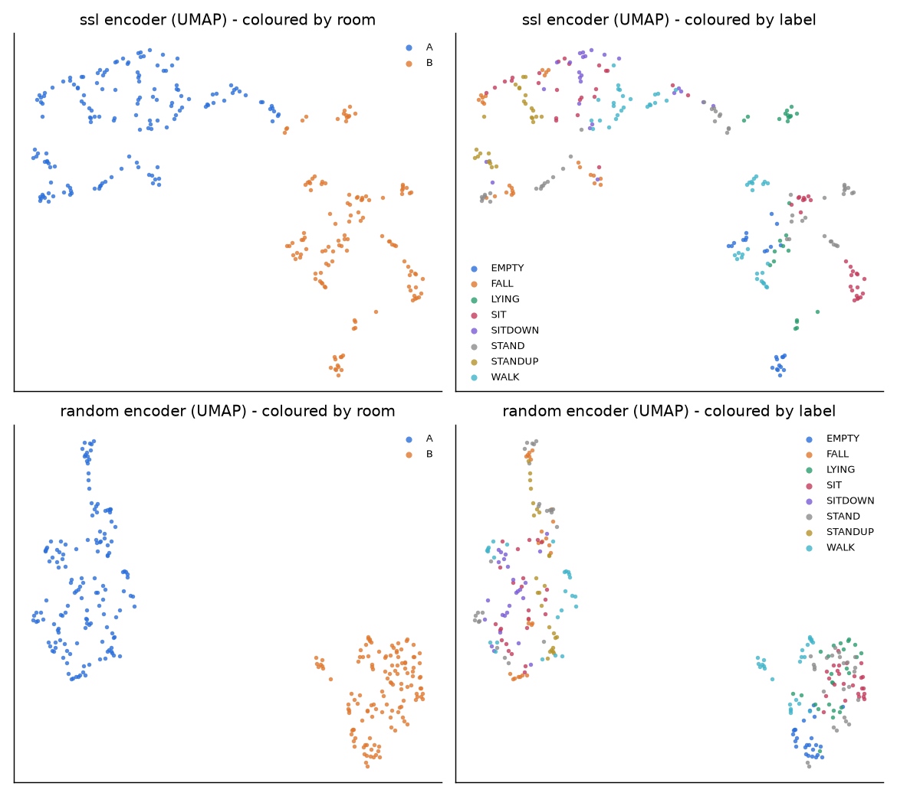
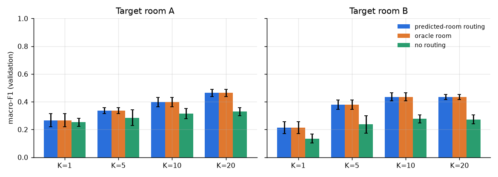
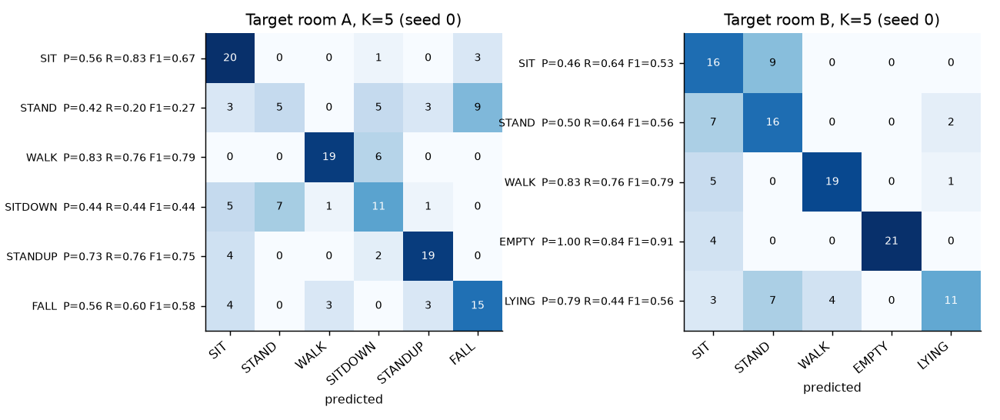
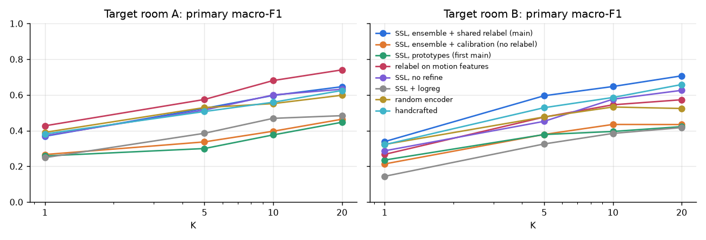
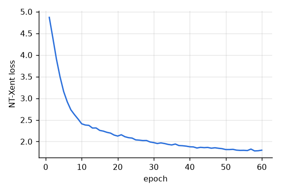

# Cross-Room Few-Shot Adaptation for WiFi CSI Activity Recognition

CS60055 Ubiquitous Computing, Hackathon Challenge 2: technical report

*Team: <names / roll numbers>*. All reported numbers are **validation** results on the fixed validation sets defined by the challenge. They are not unseen-test accuracies.

---

## 1. Summary

We built a Python pipeline from the raw challenge package to 150 × 256 amplitude windows, then a router, a self-supervised encoder, and a few-shot cross-room adapter on top of it. Each item below is a validation result.

- **Preprocessing.**
  - We wrote our own BCM4366c0 packed-float CSI decoder for Room A.
  - We found that 71% of Room A frames are legacy 20 MHz frames that sound only 64 of the 256 subcarriers, including 47k frames that *do* carry sequence numbers. QC removes them on CSI content.
  - Both rooms are exported in a common 256-column CSV form with a full provenance trail (capture → intermediate CSV → window, plus config hash).
- **Task 1 (room fingerprint).** **100% validation accuracy** on 274 fixed 150-row windows. The accuracy is still 97.8% from a *single* observation and ≥ 99.6% from 5 observations. Room is close to trivially identifiable, and Section 7 explains why this should not be read as physical room recognition.
- **Task 2 (SSL).** Linear probes on the frozen SimCLR encoder reach macro-F1 **0.932** (Room A, 6 classes), **0.992** (Room B, 5 classes) and **0.946** (joint, 8 classes). The same architecture with random weights gives 0.891 / 0.790 / 0.738, and handcrafted features give 0.932 / 0.992 / 0.909.
- **Task 3 (cross-room few-label).** The main method is SSL embeddings, per-room CORAL alignment, a prototype + logistic-regression ensemble, Sinkhorn refinement and class-balance calibration on unlabelled target-development windows, routing by the predicted room, and **shared-activity relabelling**: SIT/STAND/WALK labels are re-assigned from clusters of the target room's own unlabelled windows, named by a physical motion prior (WALK > STAND > SIT).
  - **Primary macro-F1 rises with K:** from 0.40 to 0.74 for target A (B→A) and from 0.33 to 0.73 for target B (A→B), for K = 1 → 20.
  - **Target-exclusive macro-F1 rises** from 0.40 to 0.79 (A) and from 0.25 to 0.86 (B).
  - **Shared SIT/STAND/WALK, without target labels, reach macro-F1 0.41–0.69 (A) and 0.39–0.64 (B)**, up from 0.08–0.20 when they are transferred directly from the source room. Direct transfer fails through a systematic swap (WALK ↔ SIT); relabelling avoids transfer for these classes altogether.
  - **Relabelling is the largest single gain:** the average primary macro-F1 over all 8 (target, K) cells goes from 0.366 to 0.584.
  - **Environment-aware routing still matters:** removing it costs 0.20 (A) and 0.34 (B) macro-F1 at K = 20.
  - **SSL pretraining matters most for target B:** 0.73 vs 0.55 for a random encoder at K = 20.

## 2. Data inspection (Hint 1)

`scripts/inspect_data.py` writes `results/data_inspection.json`. The findings that shaped the pipeline are listed below.

**Room A (Experiment 2):**

- 1,084 pcaps (934 dev + 150 val, 25 per class). Link type is Ethernet; every packet is IPv4/UDP to port 5500.
- 234,021 packets in total (112–251 per capture). 234,019 payloads are 1,042 bytes, which is an 18-byte Nexmon header plus 256 × 4-byte words. Two payloads are malformed (726 bytes).
- Chip field 0x006a and a single chanspec 0xe02a (80 MHz). Every frame is core 0 / spatial stream 0.
- Each capture spans about 3.9 s, so the folder name `30ms` is the ping interval, not a duration.
- About half of all frames carry sequence number 0xFFFF. Decoding them shows energy only in the lowest 20 MHz sub-band: they are legacy 20 MHz frames, not 80 MHz observations.
- A further 47,306 frames *with* valid sequence numbers have the same legacy signature. After removing all legacy frames, the valid VHT80 frames sit in the last ~2 s of each capture at ≈27 Hz (≈36 ms spacing).
- 600 frames repeat a sequence number (MAC retransmissions).

**Room B (Experiment 3):**

- 1,201 CSVs, each exactly 500 rows × 256 integer columns, with no timestamps.
- 1,196 files use the header `Subcarrier_1..256`; 5 use `0..255`.
- 4 files do not follow the `*_Amp_*` naming (`Empty_11`, `Lying_0`, `Sitting_0`, `Standing_0`). They are unique captures (no duplicate content, checked by hash) and make up the documented total of 1,201. `model_plot_1.png` is ignored.
- Subcarriers are stored in FFT-bin order, the same as our Room A decoding: guard band at bins 123–133, VHT80 pilots at bins ±11/39/75/103.
- **Room B fluctuates far more from row to row than Room A.** Each row carries a strong ripple across subcarriers whose phase shifts from row to row (`fig_qc_examples.png`, right). As a result, the median correlation between consecutive rows over data subcarriers is 0.05–0.5, against 0.999 for decoded Room A frames, and a single subcarrier in an *empty* room jumps between ≈20 and ≈1,000. Only the window-level mean profile is stable. We tried alternative decodings of Room A packets (no autoscale, mantissa only, int16 pairs), and none reproduces this signature, so we treat it as a property of the supplied amplitudes. Section 7 discusses the consequences.
- **Room B rows are not interleaved streams.** The median correlation between row *i* and row *i + k* is flat for k = 1…6 (Empty ≈ 0.39, Lying ≈ 0.39, Sitting ≈ 0.07, Standing ≈ 0.08, Walking ≈ 0.12 at every lag; 60 sampled captures, data bins only). If the rows were two alternating antennas or transmitters, lag 2 would be close to 1 while lag 1 stayed low. Instead, each Room B row behaves like an independent snapshot around a stable mean, so row order carries no motion information in Room B.

## 3. Pipeline

```
Room A .pcap ──dpkt──▶ UDP payloads (port 5500, file order)
                         │  parse 18-byte Nexmon header (magic, RSSI, fc, MAC, seq, core/ss, chanspec, chip)
                         │  BCM4366c0 packed-float → complex CSI (own vectorised decoder)
                         ▼
                      |H|  (n_frames × 256, FFT-bin order)
                         │  QC: malformed, header-consistency, legacy-20 MHz, zero, non-finite,
                         │      duplicate sequence numbers, duplicate rows
Room B .csv ───────▶ 256 amplitude columns ── QC: non-finite, zero, negative, legacy-20 MHz, duplicate rows
                         ▼
        COMMON FORM: one CSV per capture, subcarrier_001..256, one row per valid observation
                     + manifest.csv (capture id, room, label, split, source, QC counts, content hash)
                         ▼
        WINDOWS: 150 × 256 float32 .npy  + index.csv (window → capture, rows, method, config hash)
                         ▼
        NORMALISATION (fitted on development only): per-packet RMS gain → per-subcarrier standardisation
                     → guard/DC bins zeroed
                         ▼
   ┌────────────── Task 1 router ───────────────┐   ┌──── Task 2 SSL encoder (no labels) ────┐
   │ time-mean + time-std profile → logistic reg │   │ temporal CNN, SimCLR on capture pairs │
   └───────────────────┬────────────────────────┘   └───────────────┬────────────────────────┘
                       ▼                                              ▼
      Task 3: routed room → per-room embedding alignment → prototype + logreg ensemble (source labels + K support)
              → Sinkhorn-balanced refinement + class-balance calibration on unlabelled target-dev windows
              → room-restricted label space
              → shared SIT/STAND/WALK relabelled from target-room clusters, named by motion rank
                         ▼
                  predictions: window_id, room, label, confidence
```

### 3.1 CSI reconstruction (Room A)

The 4366c0 does not export int16 I/Q. Each 32-bit word holds two 11-bit magnitudes with their signs (I: bits 18–28, sign bit 29; Q: bits 6–16, sign bit 17) and a shared 6-bit two's-complement exponent (bits 0–5). We reconstruct `sign·mantissa·2^exponent` with vectorised NumPy over all packets of a capture (`csi_decode.unpack_4366c0`).

Following the public Nexmon format description, each packet is then rescaled by a power of two so that its largest component occupies 10 bits. Components whose shifted exponent falls below −12 are flushed to zero. Amplitude is `|H|`, kept in FFT-bin order with no reordering, because Room B uses the same order.

The decoded spectra look physically right: zero DC, an 11-bin guard band in the centre, smooth frequency-selective fading, and pilots visible (`results/figures/fig_qc_examples.png`).

### 3.2 Quality control

| Rule | Room A rejected | Room B rejected | Why |
|---|---:|---:|---|
| malformed payload (magic/length) | 2 | n/a | not a 256-subcarrier record |
| header inconsistency | 0 | n/a | a different chip, chanspec, or chain is not the same observation type |
| legacy-20 MHz (max sub-band energy share > 0.9) | 165,209 | 44,425 | the frame only sounds 64 of the 256 subcarriers |
| zero / constant / non-finite / negative | 0 | 0 | zero-information or invalid CSI |
| duplicate sequence number | 600 | n/a | MAC retransmission of the same frame |
| duplicate consecutive row | 0 | 0 | repeated observation |
| capture with < 20 valid observations | 7 captures (6 dev, 1 val: `validation/sit/sit201`, 2 valid frames) | 0 | no meaningful window |

The legacy-frame statistic is cleanly bimodal on Room A: VHT80 frames have a maximum sub-band share ≤ 0.8 and legacy frames ≥ 0.95, so the 0.9 threshold is not sensitive. The rule works on CSI content rather than the sequence field, because 47,306 sequenced frames are also legacy. The same rule is applied to Room B so that both rooms pass an identical validity test; it removes 7.4% of Room B rows.

After QC, Room A has 68,210 valid observations (median 59 per capture) and Room B has 556,075 (308–500 per capture).

### 3.3 Splits

- **Room A validation:** the supplied `validation/` folder (149 usable captures).
- **Room B validation:** for each class in sorted label order, candidate file names are sorted lexicographically, then `random.Random(42).sample(candidates, 25)` is drawn with a fresh RNG per class. That gives 125 captures; the remaining 1,076 are development data.
- The capture is the atomic unit: every window carries its `capture_id`, and no capture appears in both splits.
- The manifest also stores an MD5 hash of each capture's cleaned content. Duplicated captures would be dropped, and none were found.

### 3.4 Windowing (150 × 256)

- **Validation captures:** exactly one window per capture, centred (`start = (n−150)//2`), so validation scoring is capture-level.
- **Development captures:** sliding windows from row 0 with stride 50. Room B gives about 7 windows per capture. These extra windows are training augmentation only; K still counts captures.
- **Short captures (all of Room A, 20–118 valid rows):** linear interpolation along the observation axis onto 150 evenly spaced points. Because the valid VHT80 frames are nearly uniformly spaced, this is a ≈2.5× uniform time stretch.

We prefer resampling to edge padding because a padding block's length is a direct function of capture length, which is a forbidden metadata cue for room or activity prediction. The interpolation is the documented price: Room A windows are smoother than raw observations.

Windows never mix captures. `index.csv` records the source file, intermediate CSV, rows used, method, and a hash of the QC and windowing configuration for every window.

### 3.5 Normalisation

1. **Per-packet gain:** each observation is divided by its RMS over data subcarriers. The 4366c0 export rescales each packet by a power of two, and AGC varies, so absolute packet level is not a physical quantity. This step is stateless.
2. **Per-subcarrier standardisation:** mean and standard deviation are fitted on **development windows only**, pooled over both rooms. Pooling means no room label is needed at transform time, which matters for the label-free SSL stage.
3. **Null bins:** bins whose development median is below 5% of the median level in either room (DC bins 0, 1, 255 and guard bins 123–133) are set to 0 after standardisation, so their noise is not amplified to unit variance. All 256 columns are kept.

Room-specific statistics are applied later, at the embedding level (Section 6), where the room comes from the router.

## 4. Task 1: recorded-environment identification

**Method.** The router is `csihar.room.RoomRouter`. For every subcarrier it takes the time-mean and time-std of the normalised window (512 features), then applies standardisation and L2-regularised logistic regression (C = 0.05). It is fitted on all 8,462 development windows with room labels and sees only the amplitude array.

| Representation (linear classifier) | Room accuracy, 274 validation windows |
|---|---:|
| profile router (headline, used for routing) | **1.000** (A: 149/149, B: 125/125) |
| SSL embedding probe | 1.000 |
| random-encoder embedding probe | 1.000 |
| handcrafted-feature probe | 1.000 |

**Accuracy vs window length.** For each length L, the router is trained on random L-row sub-windows of development windows and tested on the centred L-row sub-window of every fixed validation window (`results/figures/fig_room_vs_length.png`).

| L (observations) | 1 | 2 | 5 | 10 | 25 | 50 | 100 | 150 |
|---|---|---|---|---|---|---|---|---|
| accuracy | 0.978 | 1.000 | 0.996 | 0.996 | 1.000 | 1.000 | 1.000 | 1.000 |
| Room A windows | 0.960 | 1.000 | 0.993 | 0.993 | 1.000 | 1.000 | 1.000 | 1.000 |
| Room B windows | 1.000 | 1.000 | 1.000 | 1.000 | 1.000 | 1.000 | 1.000 | 1.000 |

**Interpretation.** The two recordings differ in many ways besides geometry:

- the static multipath profile (the intended signal);
- the guard-band noise floor;
- per-row variability (Section 2);
- smoothness (Room A windows are resampled).

Any of these separates the rooms from a handful of observations. The fingerprint therefore identifies the *recorded environment and session*, as the challenge text cautions. It does not show that a model could recognise a third room.

## 5. Task 2: learning without labels

**Encoder.** The encoder is a 1-D temporal CNN over the (T, 256) window: a 1 × 1 "spectral" convolution from 256 to 128 channels, then four temporal convolution blocks (kernel 7/5/5/3, strides 1/2/2/2). Mean and standard-deviation pooling over time feed a linear layer that produces a 128-d embedding. Pooling makes the encoder length-agnostic and captures both the static channel shape and the motion energy.

**SSL objective.** SimCLR NT-Xent (τ = 0.2) with a 2-layer projection head.

- Batches are built from *captures*, drawn uniformly so the two rooms are roughly balanced without using room labels. Capture identity is provenance, not a label.
- The two views of a capture come from two of its windows (different temporal positions for Room B).
- Augmentations: random crop of 96–150 rows, global gain ×[0.8, 1.25], smooth random per-subcarrier gain tilt, Gaussian noise, contiguous subcarrier-band masking, and time masking.
- Time reversal is deliberately excluded because SIT-DOWN and STAND-UP are near time reversals of each other.
- Training: 60 epochs, AdamW, one-cycle learning rate, on development windows of both rooms with no activity or room labels.

**Evaluation.** The encoder is frozen. A class-balanced logistic regression is fitted on labelled development embeddings and scored on validation windows. We compare against the same architecture with random weights and against handcrafted features: per-band temporal mean, std, mean |Δ| and range over 32 subcarrier bands; four Doppler-band energies; and the dominant-PC variance ratio.

The SSL loss decreased from 4.87 to 1.80 over 60 epochs (`fig_ssl_loss.png`). Linear-probe results on the validation windows (macro-F1 / balanced accuracy):

| Representation | Room A (6 cls) | Room B (5 cls) | Joint (8 cls) | Shared A→B | Shared B→A |
|---|---|---|---|---|---|
| **SSL encoder (frozen)** | **0.932** / 0.933 | **0.992** / 0.992 | **0.946** / 0.957 | 0.235 / 0.213 | 0.175 / 0.280 |
| same CNN, random weights | 0.891 / 0.892 | 0.790 / 0.792 | 0.738 / 0.771 | 0.167 / 0.333 | 0.168 / 0.333 |
| handcrafted features | 0.932 / 0.933 | 0.992 / 0.992 | 0.909 / 0.924 | 0.167 / 0.333 | 0.168 / 0.333 |

Self-supervision improves on the random-weight encoder in every within-room setting, and most on Room B (+0.20) and joint (+0.21). It matches or beats the handcrafted baseline. The "shared" columns train a probe on one room's SIT/STAND/WALK and test on the other room. They stay at chance for every representation, which is a first sign of the transfer problem in Task 3.

`fig_embedding_2d.png` shows UMAP plots of the validation embeddings. Rooms separate completely under both encoders. Within each room, the SSL embedding forms compact activity clusters (EMPTY, LYING, SIT, STANDUP), while the random encoder mixes them. This plot is qualitative.

## 6. Task 3: cross-room few-label adaptation

**Method.** One episode is defined by a target room T, K, and a support seed:

1. **Support.** For each T-exclusive activity, draw K distinct T-development captures (sorted capture ids, `numpy.default_rng(seed)`). All windows of a chosen capture are used. Support seeds 0–4 are run for every K, and we report mean ± std.
2. **Routing.** The Task 1 router predicts each validation window's room. The routed room selects (a) the embedding alignment statistics and (b) the label space: a window routed to room R can only receive R's activities.
3. **Environment-aware alignment.** SSL embeddings are whitened with the mean and (shrunk) full covariance of their room's *unlabelled* development embeddings: CORAL-style, a feature-level analogue of AdaBN. A diagonal variant is an ablation.
4. **Classifier.** An ensemble that averages the class probabilities of two heads trained on the same data:
   - a cosine nearest-prototype head (temperature 0.1), with per-capture means averaged so one capture cannot dominate a class;
   - a class-balanced logistic regression.

   Shared-activity classes are learned from all labelled source-development windows; T-exclusive classes come from the K support captures.
5. **Transductive refinement.** Soft k-means on the target room's unlabelled development windows (never validation), initialised from the prototypes. A Sinkhorn step balances class marginals, so the in-domain support prototypes cannot absorb every target window. Support means stay as anchors.
6. **Decision calibration.** Per-class logit offsets are fitted so that the predictions on the target room's unlabelled development windows are class-balanced (log-domain column scaling, as in Sinkhorn). The same offsets are then applied to validation windows. No labels and no validation data are used to fit them.
7. **Shared-activity relabelling** (`fewshot.relabel_shared`). Steps 1–6 decide *whether* a window is a shared activity well, but transferring *which* shared activity from the source room fails (Section 7). The shared label is therefore taken from the target room itself:
   - The classifier labels the target room's unlabelled development windows. Those it calls SIT, STAND or WALK are clustered with k-means on standardised handcrafted features concatenated with the aligned SSL embedding.
   - Each cluster is named by the rank of its median **slow-motion score** under the prior WALK > STAND > SIT: the 3 lowest-motion clusters become SIT, the middle 3 STAND, and the top 3 WALK. The motion score is the temporal std of band-averaged amplitudes after a 9-row moving average. The moving average removes Room B's row-to-row ripple.
   - A validation window that the classifier calls shared takes the name of its nearest cluster. This is repeated for k = 9, 12 and 15 (`task3.relabel_k`), and the three labels are combined by majority vote. Target-exclusive predictions are unchanged.

   The prior is physical, not learned: walking moves the whole body, standing involves more postural sway than sitting. It holds in both rooms' development data (median slow-motion score, Room A: WALK 0.259, STAND 0.048, SIT 0.019; Room B: WALK 0.220, STAND 0.203, SIT 0.196; EMPTY rooms are lowest at 0.141). No target shared labels and no validation data are used to fit the clusters or name them.

Ablations, all on validation:

- predicted-room routing vs oracle room vs no routing (pooled alignment, union label space);
- with vs without refinement, and with vs without calibration;
- without relabelling (the previous main method), and relabelling on handcrafted features only or on the 3 motion features only;
- the first prototype-only method, and a logistic-regression-only head;
- random-weight encoder;
- handcrafted features;
- SSL embeddings of windows with their static per-subcarrier profile removed (to test the activity–location confound).

**Main method, mean ± std over 5 support seeds (validation).** Direction B→A means target room A; A→B means target room B.

| Metric | Target | K = 1 | K = 5 | K = 10 | K = 20 |
|---|---|---|---|---|---|
| primary macro-F1 | A | 0.402 ± 0.056 | 0.546 ± 0.031 | 0.658 ± 0.050 | 0.740 ± 0.020 |
| | B | 0.333 ± 0.038 | 0.636 ± 0.137 | 0.632 ± 0.061 | 0.725 ± 0.029 |
| target-exclusive macro-F1 | A (SIT-DOWN, STAND-UP, FALL) | 0.395 ± 0.068 | 0.570 ± 0.031 | 0.711 ± 0.029 | 0.793 ± 0.035 |
| | B (EMPTY, LYING) | 0.247 ± 0.045 | 0.669 ± 0.126 | 0.788 ± 0.069 | 0.860 ± 0.040 |
| shared macro-F1 (no target labels) | A | 0.408 ± 0.060 | 0.523 ± 0.066 | 0.604 ± 0.086 | 0.688 ± 0.055 |
| | B | 0.391 ± 0.044 | 0.614 ± 0.149 | 0.528 ± 0.109 | 0.636 ± 0.066 |
| balanced accuracy | A | 0.403 ± 0.055 | 0.544 ± 0.041 | 0.657 ± 0.049 | 0.736 ± 0.026 |
| | B | 0.338 ± 0.050 | 0.629 ± 0.144 | 0.622 ± 0.058 | 0.710 ± 0.032 |

Target-exclusive macro-F1 is identical to the previous main method because relabelling only changes windows predicted as a shared activity. The shared F1 grows with K although K labels only exclusive activities: better support makes the shared-vs-exclusive decision cleaner, so the clusters contain fewer exclusive windows.

The label-efficiency curve is `fig_label_efficiency.png`. Per-episode values are in `results/task3_results.csv`.

**Routing contribution** (primary macro-F1, `fig_routing.png`):

| Target | Routing | K = 1 | K = 5 | K = 10 | K = 20 |
|---|---|---|---|---|---|
| A | predicted room (router) | 0.402 | 0.546 | 0.658 | 0.740 |
| A | oracle room | 0.402 | 0.546 | 0.658 | 0.740 |
| A | no routing | 0.426 | 0.434 | 0.509 | 0.543 |
| B | predicted room (router) | 0.333 | 0.636 | 0.632 | 0.725 |
| B | oracle room | 0.333 | 0.636 | 0.632 | 0.725 |
| B | no routing | 0.276 | 0.383 | 0.380 | 0.383 |

Predicted routing is identical to oracle routing because the router is 100% accurate on validation. Removing routing means pooled alignment statistics and the union label space. With pooled statistics, source-room activities (for example EMPTY/LYING for target A) can steal target windows, and target embeddings are not re-centred. This costs up to 0.34 macro-F1 (target B, K = 20). Target A at K = 1 is the one cell where routing does not help (0.426 vs 0.402); with a single support capture per class, the pooled space happens to separate the exclusive classes slightly better.

**Ablations** (primary macro-F1, `fig_ablation.png`). Unless the row says otherwise, every variant uses the main method's ensemble head, refinement, calibration and relabelling.

| Variant | A K=1 | A K=5 | A K=10 | A K=20 | B K=1 | B K=5 | B K=10 | B K=20 |
|---|---|---|---|---|---|---|---|---|
| **main** (SSL, CORAL, ensemble, refine, calibrate, routed, relabel) | 0.402 | 0.546 | 0.658 | 0.740 | 0.333 | 0.636 | 0.632 | 0.725 |
| no relabelling (previous main) | 0.266 | 0.337 | 0.397 | 0.464 | 0.213 | 0.379 | 0.435 | 0.434 |
| first main (prototypes only, no calibration, no relabelling) | 0.258 | 0.300 | 0.376 | 0.447 | 0.235 | 0.378 | 0.395 | 0.422 |
| relabelling on handcrafted features only (no SSL embedding) | 0.379 | 0.541 | 0.613 | 0.672 | 0.322 | 0.588 | 0.609 | 0.711 |
| relabelling on motion features only | 0.428 | 0.577 | 0.678 | 0.738 | 0.265 | 0.476 | 0.530 | 0.562 |
| no calibration | 0.422 | 0.548 | 0.661 | 0.709 | 0.356 | 0.591 | 0.614 | 0.747 |
| no refinement | 0.401 | 0.575 | 0.682 | 0.708 | 0.331 | 0.480 | 0.689 | 0.713 |
| diagonal alignment instead of CORAL | 0.365 | 0.512 | 0.609 | 0.585 | 0.330 | 0.525 | 0.548 | 0.591 |
| logistic regression only (no refine, calibration, relabelling) | 0.249 | 0.385 | 0.469 | 0.484 | 0.147 | 0.325 | 0.384 | 0.417 |
| random-weight encoder | 0.388 | 0.534 | 0.568 | 0.584 | 0.353 | 0.461 | 0.479 | 0.545 |
| random-weight encoder, no refine | 0.451 | 0.563 | 0.604 | 0.622 | 0.288 | 0.427 | 0.511 | 0.485 |
| handcrafted | 0.321 | 0.439 | 0.487 | 0.594 | 0.293 | 0.524 | 0.581 | 0.616 |
| handcrafted, no refine | 0.348 | 0.418 | 0.458 | 0.515 | 0.311 | 0.459 | 0.533 | 0.629 |
| SSL, static profile removed | 0.217 | 0.304 | 0.338 | 0.374 | 0.322 | 0.519 | 0.561 | 0.573 |

What helps and what does not:

- **Shared-activity relabelling is the largest gain:** +0.22 primary macro-F1 averaged over the 8 cells (0.366 → 0.584), in every cell. Shared macro-F1 rises from 0.08–0.20 to 0.39–0.69.
- **Feature space for relabelling.** Clustering on the 3 motion features alone is best for target A (shared F1 0.46–0.68), where WALK is 13× more mobile than SIT. It is worst for target B (0.28–0.36), where the motion gaps are small and the 3 features cannot separate SIT from STAND. Handcrafted features plus the aligned SSL embedding are the best single choice for both rooms (8-cell average 0.584, vs 0.555 for handcrafted features alone). We use one setting for both directions rather than a per-room choice tuned on validation.
- **Routing** helps in 7 of 8 cells, by up to 0.34.
- **SSL pretraining** is the best representation for both targets at K ≥ 10 (target B: 0.63–0.73 vs 0.46–0.55 for a random encoder at K ≥ 5; target A at K = 20: 0.74 vs 0.58 random and 0.59 handcrafted).
- **CORAL** beats diagonal alignment in all 8 cells.
- **Refinement and calibration** are within noise on average (8-cell average 0.572 without refinement, 0.581 without calibration, vs 0.584). Refinement gives the largest single-cell gain (+0.16, target B, K = 5); calibration costs 0.02 at target A, K = 1.
- **Removing the static profile** before the SSL encoder is worse in every cell. With relabelling it no longer helps the shared classes either; it only weakens the shared-vs-exclusive decision.
- **Disclosure:** the main-method choices (CORAL, refinement, the ensemble and calibration, then relabelling) were made by comparing variants on validation results, which the protocol allows for design decisions.
  - For relabelling we compared cluster feature spaces (motion, SSL, handcrafted, handcrafted + motion), cluster counts (3, 6, 9, 12), k-means vs a Gaussian mixture, and an extra self-training step on the pseudo-labels, all over the same 5 seeds. The final setting clusters handcrafted features plus the aligned SSL embedding and votes over k = 9, 12, 15 (0.584, vs 0.555 for handcrafted features alone); self-training added nothing.
  - The motion prior was confirmed on the development labels of both rooms before it was used. That is a design decision informed by target-room shared labels, though no such label is used to fit or name any cluster.

**Confusion matrices at K = 5** (support seed 0; `fig_confusion_K5.png`):

| Target A | P | R | F1 |
|---|---|---|---|
| SIT | 0.56 | 0.83 | 0.67 |
| STAND | 0.42 | 0.20 | 0.27 |
| WALK | 0.83 | 0.76 | 0.79 |
| SIT-DOWN | 0.44 | 0.44 | 0.44 |
| STAND-UP | 0.73 | 0.76 | 0.75 |
| FALL | 0.56 | 0.60 | 0.58 |

| Target B | P | R | F1 |
|---|---|---|---|
| SIT | 0.56 | 1.00 | 0.71 |
| STAND | 0.68 | 0.60 | 0.64 |
| WALK | 0.83 | 0.76 | 0.79 |
| EMPTY | 1.00 | 0.84 | 0.91 |
| LYING | 0.79 | 0.44 | 0.56 |

Without relabelling, target WALK was predicted almost entirely as SIT (A: 18/25, B: 14/25) and WALK F1 was 0.00 in both rooms. With relabelling, target WALK → SIT falls to 0/25 (A) and 5/25 (B). WALK F1 is 0.79 in both rooms, and SIT F1 rises to 0.67 (A) and 0.71 (B). The remaining errors are mostly windows crossing the shared/exclusive boundary (target-A STAND → FALL/SIT-DOWN/STAND-UP 17/25, target-B LYING → STAND/WALK 11/25) and target-B STAND → SIT (8/25).

## Figures

| | |
|---|---|
|  | Decoded Room A spectrum (valid VHT80 frames vs rejected legacy-20 MHz frames), a Room A valid-frame spectrogram, and a raw Room B window. |
|  | Label-efficiency curve: macro-F1 vs K per target room; target-labelled (exclusive) vs transferred shared activities. |
|  | Encoder diagnosis: UMAP of validation embeddings, coloured by room and by activity (SSL vs random weights). |
|  | Environment fingerprint: room accuracy vs window length (fixed validation capture pool). |
|  | Routing contribution: predicted-room routing vs oracle room vs no routing. |
|  | Confusion matrices at K = 5 with per-activity precision, recall, and F1. |
|  | Ablation of relabelling, representation, refinement, and head. |
|  | SSL training loss. |

## 7. Discussion and known limitations

**Why shared activities do not transfer directly.** Within a room, activities are easy: probes reach 0.93–0.99 macro-F1. Across rooms, SIT/STAND/WALK transfer at or below chance under every representation and classifier we tried, and the errors are *systematic* (WALK ↔ SIT), not random. This is why the main method no longer transfers the shared labels and instead names target-room clusters by a motion prior (Section 6, step 7). Three causes are visible in the data:

1. **The two archives are not the same measurement.**
   - Room A's decoded VHT80 frames are smooth in time (consecutive-row correlation 0.999). Motion appears as slow, coherent amplitude changes; WALK has 5–10× the temporal variation of SIT.
   - Room B's supplied amplitudes carry a strong frequency-domain ripple whose phase shifts from row to row (`fig_qc_examples.png`, right). Consecutive rows correlate at only 0.05–0.5, even in an EMPTY room.
   - In Room B the most "variable" classes are SIT and STAND, not WALK. After per-room alignment, "high temporal variation" therefore points to WALK in A but to SIT/STAND in B, which reproduces the observed swap.
   - We cannot recover phase or undo this from amplitude-only CSVs. The rows are also not interleaved streams that could be separated (Section 2): the row-to-row correlation is the same at every lag, so Room B's motion signal cannot be aligned feature by feature with Room A's.
   - A weak slow-time signal does survive. After a 9-row moving average, the ordering WALK > STAND > SIT > EMPTY holds in Room B as in Room A, but with gaps of a few percent rather than an order of magnitude. That is too weak to transfer a classifier, but strong enough to *name* clusters. The clusters themselves come from within-room structure, where the classes separate well. A label-free method that only balances predictions (our calibration step) cannot resolve a swap; naming clusters by this prior can.
2. **Activity–location confound.** Room A activities were recorded in different spatial zones. The static profile partly encodes *where* the person was, and that does not carry over to a room of different geometry.
3. **Session confound.** The rooms were recorded in separate sessions, so the rooms are trivially separable (Task 1). The alignment statistics remove first- and second-order room differences, but not class-conditional ones.

**What works.**

- Recognising the *target-exclusive* activities from very few captures: 0.67–0.79 macro-F1 at K = 5–10 for target B, and 0.71–0.79 at K = 10–20 for target A.
- Recognising the shared activities *without* target labels by clustering the target room's unlabelled windows and naming the clusters by a motion prior: shared macro-F1 0.52–0.69 at K ≥ 5.
- Routing by environment.
- Self-supervised pretraining, which gives the best within-room representation and the best few-shot behaviour when Room B is the target.

**Limitations.**

- Room A windows are resampled (×2.5 time stretch) because no Room A capture has 150 valid 80 MHz observations.
- One Room A validation capture (`sit201`) has only 2 valid frames and is excluded, leaving 149 Room A validation windows.
- Results are capture-disjoint but *not* subject-disjoint.
- Only two environments are available.
- Validation results guided a small number of design choices (CORAL, refinement, the ensemble head, calibration, the relabelling feature space and cluster counts), so they are not unseen-test estimates.
- Calibration assumes the target room's activities are roughly equally frequent. The challenge's validation sets are balanced (25 per class), but a real deployment with a very skewed activity mix would need a prior estimated in other ways.
- Relabelling relies on the motion prior WALK > STAND > SIT and on clusters splitting into motion tertiles. In Room B the motion gaps are small, so the cluster naming is the fragile step. Activities outside this vocabulary, or a room where people stand very still, could break the ordering. It also needs enough unlabelled target-room recordings of each shared activity to form clusters.
- The random 80/20 split results in the original paper answer a different question and are not comparable.

**Future work.**

- Make relabelling more robust: choose the cluster count without validation (for example by a silhouette criterion on unlabelled data), and combine the motion prior with relational structure (matching the geometry of target clusters to source class prototypes).
- Motion features for Room A and handcrafted features for Room B each do better than either alone; a principled, label-free way to choose the feature space per room would likely help.
- Two ideas that did not work: anchoring SIT/STAND on the ends of SIT-DOWN/STAND-UP support captures (partial windows embed poorly, and STAND-UP ends land nearest SIT), and self-training a target-room classifier on the relabelled pseudo-labels (no gain).
- Alignment on the target-exclusive support classes.
- Recordings of shared activities with complex CSI in both rooms, so that phase-based features can be compared.

## 8. Pipeline independence, contribution, and AI-use disclosure

**Pipeline independence.** No source-author code, MATLAB, notebooks, processed `.mat` files, or result files were used or opened. The shared Drive folder also contains `Experiment-2.zip` and `Experiment-3.zip`, which bundle the authors' MATLAB code, results, and LSTM notebook. A first version of our download script fetched both. We listed their file names and extracted only the two ReadMe PDFs plus one data pcap (`validation/fall/fall120.pcap`) that had failed to download from the folder. The archives were then deleted without extracting or opening the code, results, or notebook. The download script now skips the archives.

The 4366c0 decoder follows the public Nexmon CSI format description and is our own vectorised implementation. Packet parsing below the UDP payload uses `dpkt`, a general-purpose PCAP library.

**Contribution statement.** *<to be completed by the team: who did ingestion/decoding, QC and windowing, SSL, few-shot adaptation, evaluation, and the report>*

**AI-use disclosure.** This project was developed with substantial help from an AI coding assistant (Claude, Anthropic). The assistant was used for data inspection, implementing the pipeline modules, running the experiments, and drafting this report. *<The team must review, understand and be able to explain every stage, and should edit this paragraph to describe their actual use, as required by the course AI-use rules.>*

## References

1. IEEE DataPort, CSI Human Activity dataset. https://ieee-dataport.org/open-access/csi-human-activity
2. J. Schäfer et al., "Human Activity Recognition Using CSI Information with Nexmon," *Applied Sciences* 11(19):8860, 2021.
3. F. Gringoli, M. Schulz, J. Link, M. Hollick, "Free Your CSI: A Channel State Information Extraction Platform for Modern Wi-Fi Chipsets," WiNTECH 2019 (Nexmon CSI).
4. T. Chen et al., "A Simple Framework for Contrastive Learning of Visual Representations (SimCLR)," ICML 2020.
5. J. Snell, K. Swersky, R. Zemel, "Prototypical Networks for Few-shot Learning," NeurIPS 2017.
6. Y. Li et al., "Revisiting Batch Normalization for Practical Domain Adaptation (AdaBN)," ICLR-W 2017.
7. B. Sun, K. Saenko, "Deep CORAL: Correlation Alignment for Deep Domain Adaptation," ECCV-W 2016.
8. M. Cuturi, "Sinkhorn Distances: Lightspeed Computation of Optimal Transport," NeurIPS 2013; Y. Hu et al., "Leveraging the Feature Distribution in Transfer-based Few-Shot Learning (PT-MAP)," 2021.
